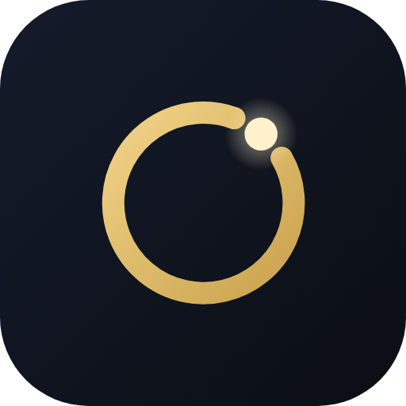

<div align="center">



# Lumora

**Block Instagram Reels and YouTube Shorts. Fully offline. Free and open source.**

</div>

---

Lumora is an Android app that stops short-form video feeds while leaving the rest of each app
alone. Messages, profiles and regular long videos keep working. It uses Android's
Accessibility Service to notice a Reel or a Short the moment it opens and takes you back out.

**No internet access.** Lumora does not even ask Android for the internet permission, so it
cannot send anything anywhere. There is no account, no analytics and no ads.

## Features

| | |
|---|---|
| **Block All** | Blocks every supported short-form feed. |
| **Daily Limit** | Allow a set amount of time each day, then block. |
| **Interval Timer** | Alternate between watching time and break time. |
| **Pause** | A short break from blocking. **Strict mode** makes you wait 20 seconds and confirm first. |
| **Schedule** | Only block between the hours you choose. |
| **Stopped today** | Shows how many times Lumora stopped you today. |
| **Usage tracking** | A timeline and averages of time spent in short-form feeds. |
| **Blocking-is-off alert** | A notification as soon as the accessibility service is switched off. |
| **Backup and restore** | Save and load your settings and usage as a file on your phone. |

**Supported:** Instagram Reels, YouTube Shorts (including YouTube Kids and ReVanced),
Facebook Reels and Snapchat Spotlight.

## Install

1. Download the latest `.apk` from the **Releases** page of this repository.
2. Open it and allow installs from your browser or file manager when Android asks.
3. Open Lumora and follow the prompt to turn on its Accessibility service.
4. On Android 13 and newer you may first need **App info → ⋮ → Allow restricted settings**.
5. Allow notifications, so the "blocking is off" alert can reach you.

Requires Android 8.0 or newer. Tested on Android 14 (ColorOS 14); other versions have not
been tested yet.

### Keep it running on Realme, OPPO, Xiaomi, Samsung and similar phones

These phones stop background apps aggressively. In Lumora's **Settings → Keep running**, open
App info and turn on **Auto launch** and set **Battery usage** to **Unrestricted**. Also lock
Lumora in the recent-apps screen.

## Why does it need the Accessibility permission?

Accessibility is the only Android feature that lets an app see which screen is open and act
on it. Lumora reads only what it needs to recognise a Reel or Short, on your device, and
stores nothing about your screen. Because the permission is powerful, the whole source code is
here for you to read. Payment and banking apps may warn about any accessibility service, so
switch Lumora off while you use them if they complain.

## Build from source

Requirements: JDK 17 or newer and the Android SDK (platform 37).

```bash
./gradlew :app:assembleDebug
# APK -> app/build/outputs/apk/debug/app-debug.apk
```

Run the tests with `./gradlew test`.

Blocking relies on the internal view names that Instagram, YouTube and the others use. When
one of those apps changes them, detection can stop working until Lumora is updated.

## License and credits

Lumora is free software under the **GNU General Public License v3.0** (see `LICENSE`).
It is built on the open-source Scrolless project, which is also GPL-3.0; see `NOTICE` for the
credits and third-party licences.

Copyright (C) 2026 Rajchhapariya
