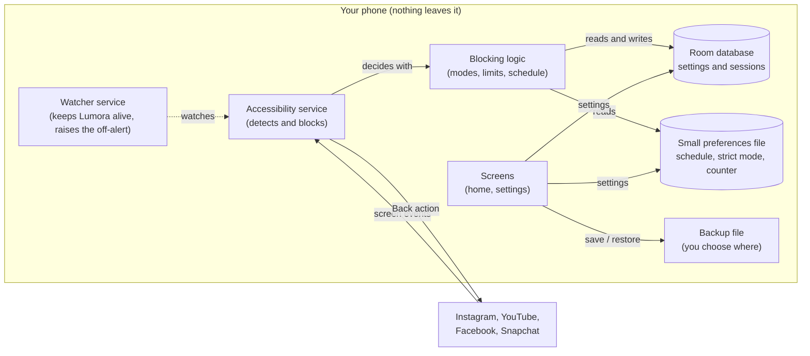
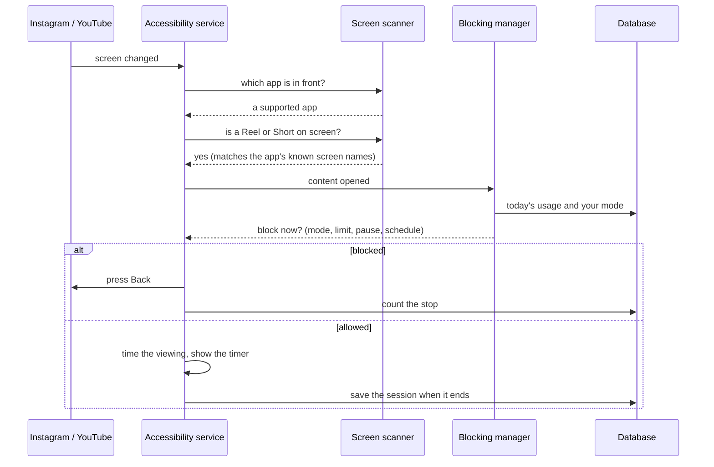

<div align="center">


# Lumora

**Block Instagram Reels and YouTube Shorts. Fully offline. Free and open source.**

</div>

---

Lumora is an Android app that stops short-form video feeds while leaving the rest of each app
alone. Messages, profiles and regular long videos keep working. It notices a Reel or a Short the
moment it opens and takes you back out, and it keeps count of how much time you spend there.

**It has no internet access.** Lumora does not even ask Android for the internet permission, so it
cannot send anything anywhere. There is no account, no analytics and no ads.

## What it does

### Blocking modes

| Mode | What happens |
|---|---|
| **Block All** | Every supported short-form feed is blocked as soon as it opens. |
| **Daily Limit** | You may watch a set amount of time each day. When it is used up, the feeds are blocked until tomorrow. |
| **Time Interval** | You may watch a short allowance (for example 5 minutes) once per break window (for example every hour). After the allowance is used, the feeds stay blocked until the window resets. |

### Extra controls

| Feature | What it does |
|---|---|
| **Pause** | Pauses blocking for a length you choose (1 to 15 minutes). A timer shows when it ends. |
| **Strict mode** | Makes Pause harder: you must wait 20 seconds and confirm before it starts. |
| **Schedule** | Blocks only between the hours you set (for example 9 AM to 9 PM). Outside them nothing is blocked. |
| **Include Stories** | Also counts and blocks Stories in Instagram, Facebook and Snapchat. |
| **Videos sent in DMs** | Lets a Reel that someone sent you in an Instagram chat play, while feed Reels stay blocked. |
| **On-screen timer** | A small floating timer shows how long you have been watching when watching is allowed. |
| **Stopped today** | A line on the home screen counts how many times Lumora stopped you today. |
| **Usage tracking** | A timeline of each viewing session, plus weekly, monthly and yearly averages. |
| **Blocking-is-off alert** | A notification appears the moment the accessibility service is switched off, and goes away when it is back on. |
| **Backup and restore** | Saves your settings and the last 90 days of usage to a file you choose, and loads it back. |
| **Look** | Dark, light or system theme, and an optional wallpaper-colour (Material You) palette. |

### Supported apps

Instagram (Reels, Stories, chat Reels), YouTube Shorts (including YouTube Kids and ReVanced),
Facebook and Facebook Lite Reels, and Snapchat Spotlight and Stories.

## Using it

1. Download the latest `.apk` from the **Releases** page and open it. Allow installs from your
   browser or file manager if Android asks.
2. Open Lumora and follow the prompt to turn on its **Accessibility** service. On Android 13 and
   newer you may first need **App info > menu > Allow restricted settings**.
3. Allow **notifications**, so the "blocking is off" alert can reach you.
4. Pick a mode on the home screen. That is all.

Requires Android 8.0 or newer. It has been tested on Android 14 (ColorOS 14) only.

### Keeping it running on Realme, OPPO, Xiaomi, Samsung and similar phones

These phones stop background apps aggressively. Open **Settings > Keep running** inside Lumora
and use **App info** to turn on **Auto launch** and set **Battery usage** to **Unrestricted**. Also
lock Lumora in the recent-apps screen. Force-stopping the app from system settings switches the
accessibility service off, and Lumora will tell you so.

### Why does it need the Accessibility permission?

Accessibility is the only Android feature that lets an app see which screen is open and act on
it. Lumora reads only the names and positions of on-screen elements it needs to recognise a Reel
or a Short, and stores nothing about what you see. Because the permission is powerful, the source
code is published so it can be checked. Payment and banking apps may warn about any accessibility
service, so switch Lumora off while you use them if they complain.

## How it works (system design)

### Parts of the app



### From a Reel opening to the block



### The main pieces

| Piece | Job |
|---|---|
| **Accessibility service** | Receives screen events from the supported apps, finds Reels and Shorts, and presses Back when blocking applies. While idle it listens only to the supported apps; while one is open it listens more widely, so it notices you leaving. |
| **Screen scanner** | Works out which supported app is in front and whether its Reel, Short or Story screen is showing, using the app's internal screen names and layout. |
| **Blocking manager** | One handler per mode (Block All, Daily Limit, Time Interval, none). It answers "block now?" from your usage, your limits, any pause and the schedule. |
| **Sessions and usage** | Each stretch of viewing is saved as a session. Daily and interval totals, the timeline and the averages are built from them. |
| **Watcher service** | A small foreground service that asks Android to keep Lumora running on phones that freeze idle apps. It also watches the accessibility setting and raises the "blocking is off" alert, and it restarts after a reboot. |
| **Storage** | A local Room database for settings and sessions, and a small preferences file for the schedule, strict mode, stopped-today counter and setup flag. Nothing is synced anywhere. |
| **Backup** | Writes and reads one JSON file through Android's file picker. |

### Code layout

```
app/                    Accessibility service, overlays, watcher service, backup, app shell
core/domain/            Models, blocking handlers and manager, schedule and counter preferences
core/data/              Room database and repositories
core/designsystem/      Theme, colours, shared components
core/logging/           Logging helpers
feature/home/           Home screen, timeline, dialogs
feature/settings/       Settings screen
```

## Limits to know about

- Blocking depends on the internal screen names that Instagram, YouTube and the other apps use.
  When an app changes them in an update, detection can stop working until Lumora is updated.
- Because Lumora has no internet access, it cannot update itself. A new version has to be
  installed by hand.
- Stories and chat Reels are matched by the apps' screen names and can occasionally be misjudged.

## License and credits

Lumora is free software under the **GNU General Public License v3.0** (see `LICENSE`). It is built
on the open-source Scrolless project, which is also GPL-3.0; see `NOTICE` for the credits and
third-party licences.

Copyright (C) 2026 Rajchhapariya

## Building from source

The Gradle wrapper jar is not stored in the repository. After cloning, run `sh scripts/fetch-wrapper.sh` once. It downloads the official jar and verifies its checksum. Then build with `./gradlew assembleRelease`.
